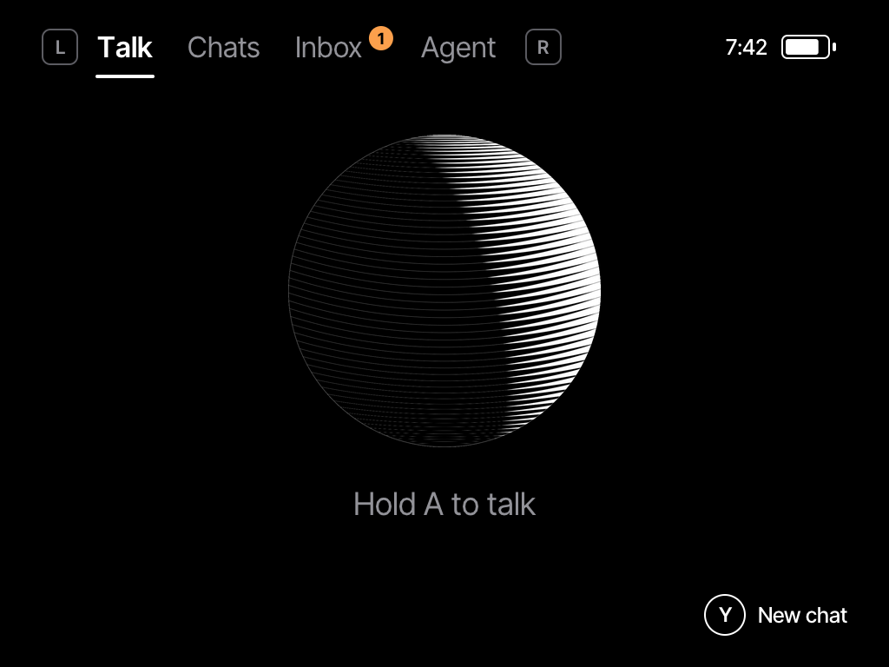
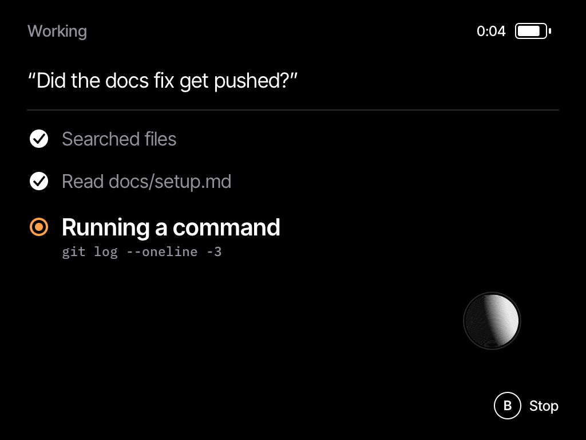
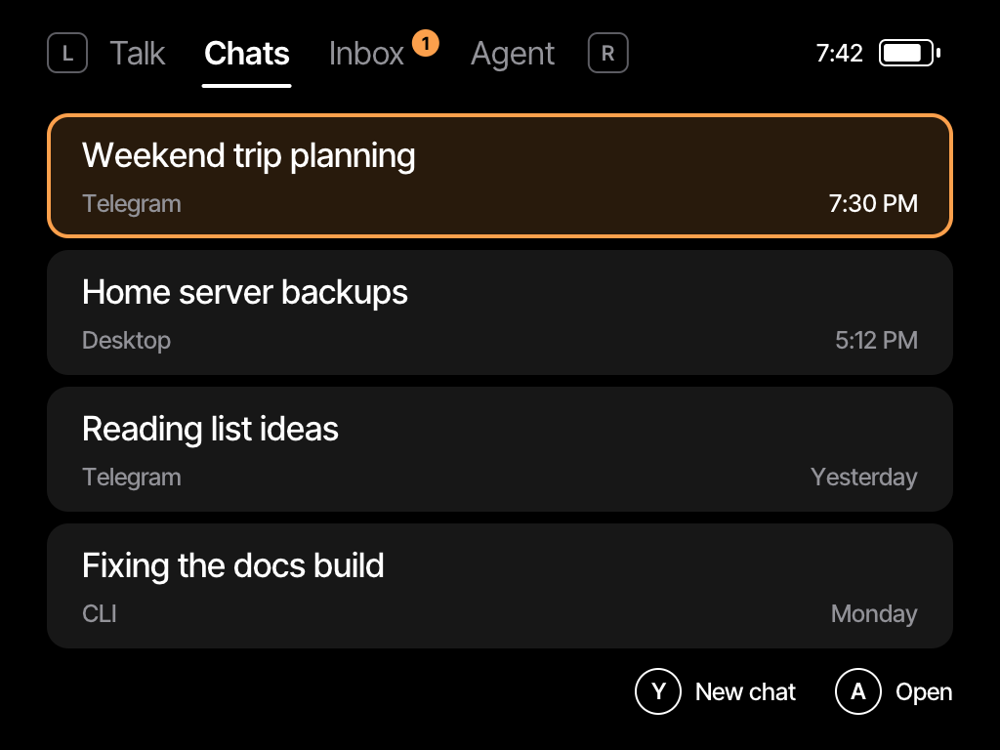

# pocket-hermes

A handheld voice client for [Hermes Agent](https://github.com/NousResearch/hermes-agent). Hold a button on a TrimUI Brick, talk, and watch your agent work.

 
 

## What it does

- **Talk:** hold A, speak, let go. Your words go to your own Hermes agent.
- **Live steps:** see each tool as it runs, then the reply as it's written.
- **Chats:** read chats from your other Hermes surfaces, and continue the ones started on the handheld.
- **Inbox:** failed routines and background results.
- **Agent:** model, gateway, routines and achievements at a glance.
- **Look & Feel:** canvas, accent color, loading indicator, and optional read-aloud.

## How it fits together

The handheld only ever talks to a small relay, which runs next to Hermes. The relay turns your audio into text, calls the Hermes API server and passes back tool steps and the reply. Your Hermes API key stays on the server.

```
Brick  --Tailscale-->  relay  -->  Hermes API server
                         |
                         +-- faster-whisper (speech to text, local)
                         +-- Cartesia (read aloud, optional)
```

## Requirements

- A TrimUI Brick on stock firmware. That's the only device tested so far.
- A running Hermes Agent with its API server enabled.
- [uv](https://docs.astral.sh/uv/) and `ffmpeg` on the machine running the relay.
- Tailscale on both ends is strongly recommended. The relay speaks plain HTTP.
- A Cartesia key, only if you want replies read aloud.

## Set up the relay

```sh
git clone https://github.com/ptaranat/pocket-hermes ~/pocket-hermes
mkdir -p ~/.config/pocket-hermes
openssl rand -hex 32 > ~/.config/pocket-hermes/token
cp ~/pocket-hermes/relay/relay.env.example ~/.config/pocket-hermes/relay.env
```

Fill in `relay.env`, then run it as a user service:

```sh
cp ~/pocket-hermes/relay/pocket-hermes-relay.service ~/.config/systemd/user/
systemctl --user daemon-reload
systemctl --user enable --now pocket-hermes-relay
```

## Install on the Brick

You'll need [just](https://github.com/casey/just), [uv](https://docs.astral.sh/uv/) and SDL2 headers on your computer. `just arm` cross-compiles with Zig, which uv fetches for you.

1. Run `just arm`.
2. Copy `build/arm/pocket-hermes` and `assets/` to `/mnt/UDISK/pocket-hermes/` on the Brick.
3. Copy `packaging/config.example` there as `config`, and fill in your relay address and token.
4. Copy `packaging/PocketHermes/` to `/mnt/SDCARD/Apps/`.
5. Open **Hermes** from the Apps menu.

Stock firmware gives you a root shell over USB with adb, which is the easiest way to copy files.

## Controls

| Button | Action |
|---|---|
| A | Hold to talk, or open |
| B | Back, cancel or stop |
| X | Read aloud or replay |
| Y | New chat, or Look & Feel from Agent |
| L, R | Switch tabs |
| D-pad | Move and scroll, hold to keep going |
| Menu | Quit |

## Develop on a computer

```sh
just run --demo   # opens a window with sample data
just shots        # renders every screen to build/shots
```

On a computer, Z is A, X is B, A is X, S is Y, Q and W are the shoulders, and Esc quits. The UI kit in `kit/` draws into one pixel buffer, so a computer and the Brick render the same frames. SDL2 is its only dependency.

## Security

Think of the relay token as access to your agent. Whatever tools your Hermes API server exposes, anyone holding that token can use. The Brick has no lock screen, and its USB port gives a root shell, so anyone with the device can get the token.

- Keep the relay on your tailnet, never a public interface.
- Give the handheld its own Tailscale tag, limited to the relay's port.
- If a device goes missing, remove it from your tailnet and rotate the token.

## Disclaimer

pocket-hermes is an unofficial community project. It is not affiliated with or endorsed by Nous Research. Hermes, the Nous name and the Nous artwork used in the app icon belong to Nous Research.

## License

MIT, see [LICENSE](LICENSE). Third-party credits are in [THIRD_PARTY.md](THIRD_PARTY.md).
